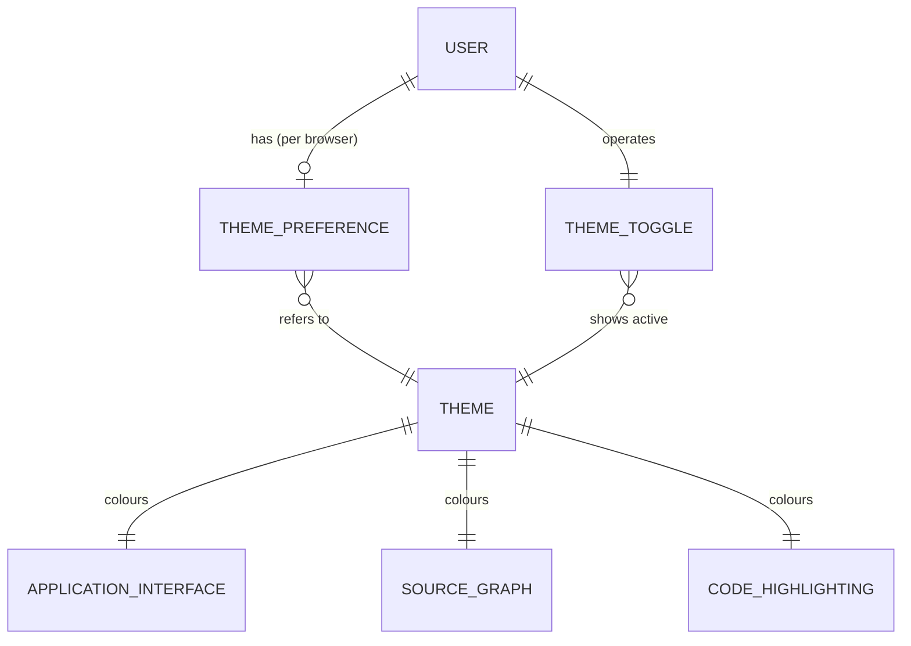
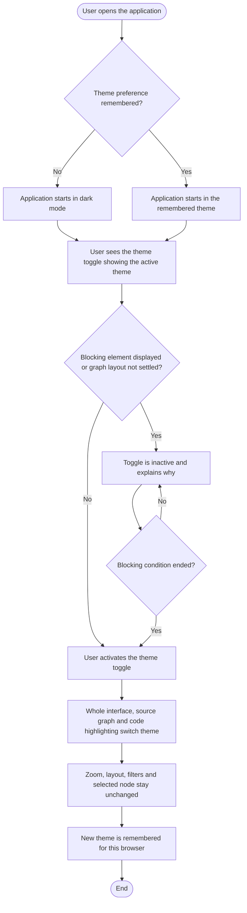
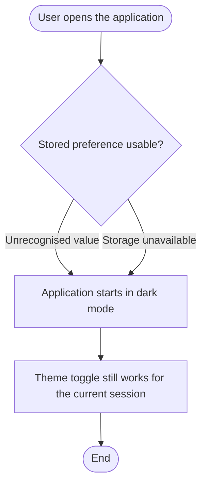
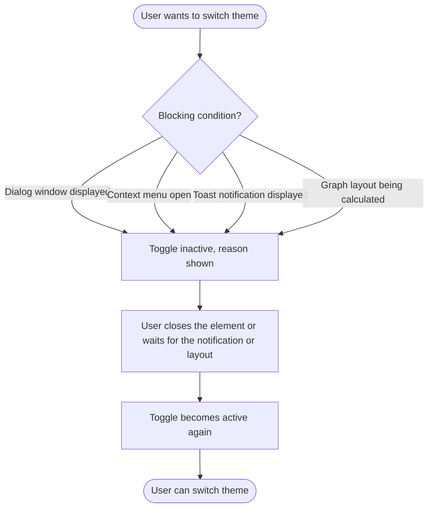

# Theme Switching (Dark / Light Mode) — Code Analyst

> A Code Analyst user can toggle the frontend between dark mode and light mode so that the source graph and the rest of the application are readable in the theme they prefer or that suits their environment.

## Business purpose

The application currently supports dark mode only. Users working in bright environments, or who simply prefer a light interface, cannot comfortably read the source graph and the surrounding screens. Theme switching lets each user choose the theme that suits them, and remembers that choice, without changing the default experience for anyone who never chooses.

## Key concepts and entities

- **Theme** — the colour scheme of the whole application. Two themes exist: *dark* (default) and *light*.
- **Theme toggle** — the control in the application layout that switches the theme and shows which theme is currently active.
- **Theme preference** — the theme a user last chose, remembered for that user in that browser.
- **Application interface** — all visible screens and elements: panels, toolbars, dialogs, tables, text, borders, tooltips and code blocks.
- **Source graph** — the graph of the analysed code, including node labels, edges, edge labels, the selection highlight, the grid and the legend.
- **Code highlighting** — the syntax colouring of source code in the code viewer and in code snippets.
- **Dialog window** — a window displayed over the application that requires the user's attention before continuing (for example a deletion confirmation).
- **Blocking element** — an element that makes theme switching unavailable while it is displayed: a dialog window, a context menu or a toast notification. The analysis options drawer is not a blocking element.
- **Graph layout** — the arrangement of nodes in the source graph; it is *settled* once its calculation has finished.

## Entity relationships



## Main flows

### Nominal flow (happy path)



### Exception flows

**Remembered preference cannot be restored**



**Theme switching blocked**



## Business rules

1. The default theme is dark. A user who has never chosen a theme in this browser sees dark mode.
2. A theme toggle is available in the application layout and always indicates the currently active theme.
3. Activating the toggle switches between dark and light mode, and the source graph background changes accordingly.
4. The chosen theme is remembered per browser: reloading the page or opening the application again in the same browser starts it in the chosen theme.
5. If the remembered preference cannot be restored (unrecognised value or unavailable storage), the application starts in dark mode and the toggle still works for the current session.
6. At startup the remembered theme is applied from the first rendered screen; the opposite theme is never displayed while loading.
7. The whole application interface follows the selected theme with no exceptions: panels, toolbars, dialogs, tables, text, borders, tooltips and code blocks. No element keeps the colours of the other theme.
8. In both themes, text (node labels, edge labels, legend and interface text) has a contrast of at least 4.5:1 against its background, and graphical elements (edges, selection highlight, grid, node outlines, interactive component boundaries) have a contrast of at least 3:1. Node type colours remain distinguishable from each other. Nodes have no outline today and none is added, so the node-outline requirement applies only if an outline is introduced; the node fill colour itself keeps at least 3:1 against the graph background.
9. The current dark theme does not yet meet these contrast thresholds; correcting it is part of this scope.
10. Code highlighting follows the selected theme in both the code viewer and code snippets.
11. Switching the theme leaves the graph's zoom, layout, filters and selected node unchanged, and no loading indicator is displayed.
12. The theme can be switched only when no blocking element (dialog window, context menu or toast notification) is displayed and the graph layout is settled. Otherwise the toggle is inactive and explains why. It becomes active again as soon as the blocking condition ends. The analysis options drawer does not block theme switching.
13. The theme toggle is operable with the keyboard only; its accessible name and current state are exposed to assistive technology.
14. When several blocking conditions apply at the same time, the inactive toggle explains one reason, chosen by priority: dialog window first, then context menu, then toast notification, then graph layout being calculated. The toggle becomes active again only when none of them applies.

**Out of scope**
- Following the operating system colour-scheme setting. Dark remains the default; this is a candidate follow-up.
- A third "system" option in the toggle.
- Storing the preference on a server or sharing it across devices, and live synchronisation between open tabs (a change reaches another open tab only after it is reloaded).

## NFR - Non Functional Requirements

NFR-1 — Data: the theme preference is stored locally in the browser (`localStorage`); there is no backend storage.
NFR-2 — Performance / UI: the stored theme is applied before the first render (for example by setting a `data-theme` attribute on the root element before the application mounts) to avoid a flash of the wrong theme.
NFR-3 — Integration: changing the theme does not trigger any request for graph data to the backend.
NFR-4 — Compliance (accessibility): contrast is measured against WCAG AA — 4.5:1 for text, 3:1 for graphical elements and interactive component boundaries.
NFR-5 — UI/UX: the light palette is defined as an override of the existing theme colour tokens (including the graph tokens `--color-graph-*` in the `@theme` block of `frontend/src/assets/main.css`) so that components need no per-theme logic; exact light palette values are defined during implementation.
NFR-6 — UI/UX: the graph stylesheet (`graphStylesheet.ts`) must be re-applied on theme change if its colours are resolved only once, and the static `highlight.js/styles/github-dark.css` import (in `CodeViewer.vue` and `CodeSnippet.vue`) is replaced by a stylesheet loaded per theme.

## Test data reference

| Identifier | Example value | Format | Semantic |
|---|---|---|---|
| `initial_theme` | "dark" | text: "dark" or "light" | Theme active before the user switches. |
| `target_theme` | "light" | text: "dark" or "light" | Theme active after the user switches. |
| `chosen_theme` | "light" | text: "dark" or "light" | Theme the user last chose in this browser. |
| `stored_theme` | "light" | text: "dark" or "light" | Theme found in the remembered preference at startup. |
| `default_theme` | "dark" | text: "dark" or "light" | Theme used when no usable preference exists. |
| `theme` | "light" | text: "dark" or "light" | Theme under evaluation in a scenario. |
| `stored_preference_state` | "unrecognised value" | text: "unrecognised value" or "unavailable storage" | Why the remembered preference cannot be restored. |
| `text_contrast_min` | "4.5:1" | contrast ratio | Minimum contrast for text against its background. |
| `graphic_contrast_min` | "3:1" | contrast ratio | Minimum contrast for graphical elements against the graph background. |
| `blocking_condition` | "a dialog window is displayed" | text | Situation in which theme switching is unavailable. |
| `blocking_reason_message` | "Close the dialog window to change the theme" | text | Explanation shown by the inactive toggle for the blocking condition. |

## Acceptance criteria (Gherkin)

```gherkin
Feature: Theme switching (dark / light mode)

  # SC1
  Scenario: Theme toggle is available
    Given I have opened the application
    Then I see a dark/light mode toggle in the application layout
    And it indicates the currently active theme

  # SC2
  Scenario Outline: Switch theme
    Given the application is in <initial_theme> mode
    When I activate the theme toggle
    Then the application switches to <target_theme> mode
    And the source graph background changes to the <target_theme> background

    Examples:
      | initial_theme | target_theme |
      | "dark"        | "light"      |
      | "light"       | "dark"       |

  # SC3
  Scenario Outline: Theme choice is remembered
    Given I switched to <chosen_theme> mode
    When I reload the page or open the application again in the same browser
    Then the application starts in <chosen_theme> mode

    Examples:
      | chosen_theme |
      | "light"      |
      | "dark"       |

  # SC4
  Scenario Outline: Default theme is unchanged for new users
    Given I have never chosen a theme in this browser
    When I open the application
    Then the application is in <default_theme> mode

    Examples:
      | default_theme |
      | "dark"        |

  # SC5
  Scenario Outline: Theme preference cannot be restored
    Given the stored theme preference is <stored_preference_state>
    When I open the application
    Then the application is in <default_theme> mode
    And the theme toggle still works for the current session

    Examples:
      | stored_preference_state | default_theme |
      | "unrecognised value"    | "dark"        |
      | "unavailable storage"   | "dark"        |

  # SC6
  Scenario Outline: Stored theme is applied without visible flicker
    Given I previously chose <stored_theme> mode
    When I open the application
    Then the first rendered screen already uses <stored_theme> mode
    And the opposite theme is never displayed during loading

    Examples:
      | stored_theme |
      | "light"      |

  # SC7
  Scenario: The whole interface follows the theme
    Given I switch the theme
    Then panels, toolbars, dialogs, tables, text, borders, tooltips and code blocks use the colours of the selected theme
    And no element keeps the colours of the other theme

  # SC8
  Scenario Outline: Graph content stays legible in both themes
    Given the application is in <theme> mode and a graph is displayed
    Then node labels, edge labels and the legend have a contrast of at least <text_contrast_min> against their background
    And edges, the selection highlight, the grid and node outlines have a contrast of at least <graphic_contrast_min> against the graph background
    And node type colours remain distinguishable from each other

    Examples:
      | theme   | text_contrast_min | graphic_contrast_min |
      | "light" | "4.5:1"           | "3:1"                |
      | "dark"  | "4.5:1"           | "3:1"                |

  # SC9
  Scenario: Code highlighting follows the theme
    Given I am viewing source code in the code viewer or a code snippet
    When I switch the theme
    Then the syntax highlighting uses a stylesheet matching the selected theme

  # SC10
  Scenario: Switching theme does not disturb the graph
    Given a graph is displayed with a given zoom, layout, filters and selected node
    When I switch the theme
    Then the zoom, layout, filters and selected node are unchanged
    And no loading indicator is displayed

  # SC11
  Scenario Outline: Toggle is accessible
    Given I navigate with the keyboard only
    Then I can focus and activate the theme toggle
    And its accessible name and current state are exposed to assistive technology
    And text and interactive elements have a contrast of at least <text_contrast_min> in <theme> mode

    Examples:
      | theme   | text_contrast_min |
      | "light" | "4.5:1"           |
      | "dark"  | "4.5:1"           |

  # SC12
  Scenario Outline: Theme switching is unavailable while blocked
    Given <blocking_condition>
    Then the theme toggle is inactive
    And it shows the explanation <blocking_reason_message>

    Examples:
      | blocking_condition                           | blocking_reason_message                       |
      | "a dialog window is displayed"               | "Close the dialog window to change the theme" |
      | "a context menu is open"                     | "Close the context menu to change the theme"  |
      | "a toast notification is displayed"          | "Wait for the notification to disappear"      |
      | "the graph layout is being calculated"       | "Wait for the graph layout to finish"         |

  # SC13
  Scenario Outline: Theme switching becomes available again
    Given the theme toggle is inactive because <blocking_condition>
    When <blocking_condition> no longer applies
    Then the theme toggle becomes active again

    Examples:
      | blocking_condition                           |
      | "a dialog window is displayed"               |
      | "a context menu is open"                     |
      | "a toast notification is displayed"          |
      | "the graph layout is being calculated"       |
```

## Changelog

| Version | Date | Author | Changes |
|---------|------|--------|---------|
| 0.1.0 | 2026-11-01 | gszewc | Document created. |
| 0.1.0 | 2026-11-01 | gszewc | Blocking rule clarified: context menu and toast notifications block theme switching, the analysis options drawer does not; open gap closed. |
| 0.1.0 | 2026-11-08 | gszewc | Added rule 14 (reason priority when several blocking conditions apply) and a node-outline note under rule 8, from the technical preparation for #4. |

## Sources

| Section | Source | Type | Reference |
|---|---|---|---|
| Business purpose, rules 1–11, 13, scenarios SC1–SC11, NFR-1..NFR-6, out of scope | GitHub issue #4 (description rewritten after `/review-us`) | GitHub Issue | https://github.com/gszewc/code_analyst_test/issues/4 |
| Rules 5–6, 8–9, SC5, SC6, SC8, SC11, NFR-1, NFR-4 | PO clarification during `/review-us` (storage fallback, no flicker, WCAG AA thresholds 4.5:1 / 3:1, local browser storage, no live cross-tab sync) | PO decision | Review comment on #4 dated 2026-11-01: https://github.com/gszewc/code_analyst_test/issues/4 |
| Rule 12, SC12, SC13 (blocking elements) | PO clarification after `/gen-docs` (context menu and toast notifications block theme switching; the analysis options drawer does not) | PO decision | This session, 2026-11-01 |
| Rules 9, 12, SC12, SC13 | PO clarification during `/gen-docs` (current dark theme does not meet WCAG AA and is fixed in scope; switching only without dialog windows and with settled layout; toggle inactive with explanation) | PO decision | This session, 2026-11-01 |
| Rule 14 (blocking reason priority), rule 8 node-outline note | Technical preparation for #4 (clarification interview, assumption A-3 and node-outline reading accepted by the user) | Tech preparation | `docs/tech-preparation/docs/4-theme-switching-technical-preparation.md` |
| Entities (dialog windows, context menu, drawer, toasts), current state (dark only, static `github-dark.css`, no graph export) | Frontend source | Code | `frontend/src/components/analysis/DeleteConfirmationModal.vue`, `components/ui/ContextMenu.vue`, `components/ui/ToastContainer.vue`, `components/analysis/AnalysisOptionsDrawer.vue`, `components/code/CodeViewer.vue`, `assets/main.css` (repo `gszewc/code_analyst_test`) |
