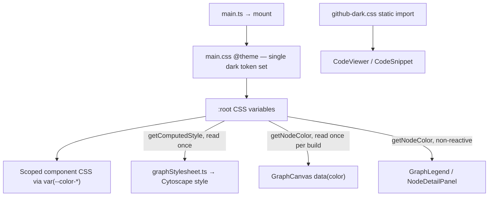
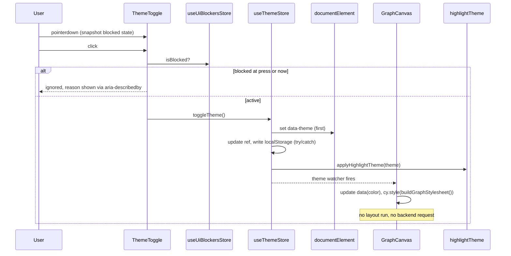

# 4 — Theme switching (dark / light mode)

| Field | Value |
|-------|-------|
| **Status** | Approved |
| **Date** | 2026-11-08 |
| **Authors** | gszewc (drafted with Claude, lead-architect) |
| **Issue** | [#4](https://github.com/gszewc/code_analyst_test/issues/4) — As a user, I want to toggle between dark and light mode so that I can read the source graph in the theme I prefer |
| **KB document** | `docs/knowledge-base/docs/ui/theme-switching/theme-switching-0.1.0.md` (v0.1.0) |
| **Related ADR** | — (no ADR exists for this profile yet; see *ADR Candidates*) |
| **Last revision** | — |

Scope: frontend only (`frontend/`). No backend, database or API change. Scope assessment: High (13 ACs); the user chose to proceed with the full scope as one unit.

---

## Current code context

All paths are relative to the application repository root (`gszewc/code_analyst_test`).

**Colour tokens.** A single dark palette lives in the Tailwind `@theme` block (`frontend/src/assets/main.css:5`–`97`): surfaces `--color-bg-*` (`:7`–`11`), borders (`:13`–`15`), text (`:17`–`20`), amber accent (`:23`–`26`), status colours (`:29`–`32`), node-type colours (`:35`–`46`), graph tokens `--color-graph-*` (`:49`–`54`), status and danger tint tokens (`:57`–`72`), tooltip tokens (`:94`–`96`). `html { color-scheme: dark }` is hard-coded at `frontend/src/assets/main.css:104`–`106`. A production build (`vite build`, run for this analysis into a temp dir) emits every token under `:root,:host{…}`, including ones no utility class uses, so a `:root[data-theme='light']` override block is sufficient.

**Derived graph tokens.** `--color-graph-edge` aliases `--color-text-disabled` and `--color-graph-edge-text` aliases `--color-text-muted` (`frontend/src/assets/main.css:50`–`51`); the grid is `rgba(255,255,255,0.04)` (`:54`). Aliases resolve on the element that declares them, so overrides must be declared on `<html>` (the same element as `@theme`'s `:root`).

**Bootstrap.** `frontend/src/main.ts:21`–`35` creates the app, installs Pinia/VueQuery/router, imports `./assets/main.css` (`:6`) and mounts. `frontend/index.html:3`–`12` has no inline script and no theme attribute. Nothing in `frontend/src` touches `localStorage` (only `GraphFilterDock.vue:48`/`:69` use `sessionStorage`). `frontend/nginx.conf` sets no CSP header, so an inline pre-paint script is allowed.

**Layout shell.** `frontend/src/layouts/AppLayout.vue:45`–`156` is the sidebar (header with collapse toggle `:71`–`87`, nav `:90`–`155`); it has an expanded (220 px) and a collapsed (72 px) state driven by `useAppStore` (`frontend/src/stores/useAppStore.ts:10`, `:14`). `ToastContainer` is mounted in the shell (`AppLayout.vue:167`–`168`).

**Graph colours are resolved once.**
- `buildGraphStylesheet()` reads each CSS variable via `getComputedStyle` when called (`frontend/src/components/graph/graphStylesheet.ts:1`–`4`, uses at `:13`, `:28`, `:43`–`49`, `:58`). Nodes have `border-width: 0` (`:21`) — there is no node outline today.
- `GraphCanvas.vue` bakes each node colour into `data(color)` when elements are built (`frontend/src/components/graph/GraphCanvas.vue:29`) and applies the stylesheet once at construction (`:71`).
- The fcose layout is started by the Cytoscape constructor (`GraphCanvas.vue:72`–`78`) and again on data change (`:173`–`186`); only a one-shot `layoutstop` handler exists (`:49`). Layout state is not exposed anywhere.
- Filters are applied as element-level style bypasses (`GraphCanvas.vue:116`, `:119`) and classes (`:128`–`134`); zoom/pan/selection live in Cytoscape and `useGraphStore` (`frontend/src/stores/useGraphStore.ts:49`–`52`).
- The canvas background and grid are scoped CSS (`GraphCanvas.vue:196`–`203`).
- `getNodeColor` reads the variable at call time (`frontend/src/constants/nodeColors.ts:33`–`37`); callers that are not reactive to a theme change: `GraphLegend.vue:15`–`18` and `NodeDetailPanel.vue:83` (which also builds `${nodeColor}22`/`44` hex-alpha strings at `:99`, so node tokens must stay 6-digit hex).

**Code highlighting.** `highlight.js/styles/github-dark.css` is imported statically in `frontend/src/components/code/CodeViewer.vue:6` and `frontend/src/components/code/CodeSnippet.vue:6`; Vite emits it as a global CSS chunk. `useCodeHighlight` only produces HTML (`frontend/src/composables/useCodeHighlight.ts:76`–`107`) and is theme-agnostic. Line numbers use an undefined `--color-text-tertiary` with fallback `#6e7681` at `opacity:.6` (`CodeViewer.vue:165`, `CodeSnippet.vue:101`).

**Blocking elements today (four sources, no shared signal).**
- Teleported modal with `role="dialog"`: `frontend/src/components/analysis/DeleteConfirmationModal.vue:18`, `:27`–`28`, opened from `AnalysisPage.vue:198`–`204` (`showDeleteModal`, `:63`).
- Three inline dialogs (`.dialog-backdrop`) in `frontend/src/pages/DashboardPage.vue`: create (`:199`–`203`, `showCreateDialog` `:26`), rename (`:272`–`276`, `renamingProject` `:57`), delete (`:342`–`346`, `deletingProject` `:94`).
- Context menu: mounted only by `frontend/src/pages/FilesPage.vue:256`–`262` (`contextMenuVisible` `:40`); it closes on `mousedown` outside itself (`frontend/src/components/ui/ContextMenu.vue:31`–`36`, listener `:48`–`51`).
- Toasts: `frontend/src/stores/useToastStore.ts:14`–`18` (auto-dismiss after 3500 ms).
- Not blocking by PO decision: `AnalysisOptionsDrawer` (`AnalysisPage.vue:186`–`196`), `NodeDetailPanel` slide-over (`NodeDetailPanel.vue:87`).

**Hard-coded colours outside the tokens.**
- `#000` on accent buttons: `AnalyseButton.vue:61`, `NodeDetailPanel.vue:431`, `SettingsPage.vue:396`, `DashboardPage.vue:546`.
- Tinted status/danger/warning surfaces as raw `rgba(...)`: `SettingsPage.vue:344`–`345`, `:356`–`357`, `:381`–`382`, `:387`–`388`; `AnalysisPage.vue:286`–`293`; `DashboardPage.vue:533`–`534`; `GraphPage.vue:136`–`137`.
- Danger button `#993333` / `#b33`: `DeleteConfirmationModal.vue:193`, `:198`.
- Scrims `rgba(0,0,0,.6/.7)`: `DeleteConfirmationModal.vue:93`, `DashboardPage.vue:454`; neutral black shadows (`ContextMenu.vue:87`, `ToastContainer.vue:69`, `AnalysisOptionsDrawer.vue:146`, `GraphFilterDock.vue:174`).

**Current dark palette vs WCAG AA** (computed from the token values with the WCAG relative-luminance formula):

| Token / pair | Ratio now | Required | Result |
|---|---|---|---|
| `text-muted` on `bg-base` / `bg-panel` | 2.82 / 2.52 | 4.5 | Fail |
| `graph-edge` (`text-disabled`) on `bg-base` | 1.71 | 3 | Fail |
| `graph-edge-text` on `bg-base` | 2.82 | 4.5 | Fail |
| `border` on `bg-base` / `bg-panel` | 1.43 / 1.28 | 3 (interactive boundaries) | Fail |
| `graph-grid` blended on `bg-base` | 1.08 | 3 | Fail |
| `node-external-module` on `bg-base` | 2.24 | 3 | Fail |
| `text-primary`, `text-secondary`, `accent`, other node colours | 4.23 – 15.86 | 3 / 4.5 | Pass |



---

## Dependencies on other developments

**No dependencies identified.** Issue #4 has no linked issues, no milestone and no parent. Codebase analysis found nothing the story needs that does not already exist: no backend, API or database change; `highlight.js@^11.11.1` (`frontend/package.json`) already ships `styles/github.css`; `lucide-vue-next` already provides Sun/Moon icons. No stubs are required.

---

## Acceptance Criteria

Transcribed verbatim from the live GitHub payload of issue #4 (fetched 2026-11-08), in issue order, one scenario per row (line breaks shown as `<br>`). The Spec-validation preflight (Procedure 0.7) was **waived by the user** — see *Risks*.

| # | Acceptance criterion |
|---|------------------------|
| R-01 | Scenario: Theme toggle is available<br>Given I have opened the application<br>Then I see a dark/light mode toggle in the application layout<br>And it indicates the currently active theme |
| R-02 | Scenario Outline: Switch theme<br>Given the application is in \<initial_theme\> mode<br>When I activate the theme toggle<br>Then the application switches to \<target_theme\> mode<br>And the source graph background changes to the \<target_theme\> background<br>Examples: initial_theme "dark" → target_theme "light"; "light" → "dark" |
| R-03 | Scenario Outline: Theme choice is remembered<br>Given I switched to \<chosen_theme\> mode<br>When I reload the page or open the application again in the same browser<br>Then the application starts in \<chosen_theme\> mode<br>Examples: chosen_theme "light"; "dark" |
| R-04 | Scenario Outline: Default theme is unchanged for new users<br>Given I have never chosen a theme in this browser<br>When I open the application<br>Then the application is in \<default_theme\> mode<br>Examples: default_theme "dark" |
| R-05 | Scenario Outline: Theme preference cannot be restored<br>Given the stored theme preference is \<stored_preference_state\><br>When I open the application<br>Then the application is in \<default_theme\> mode<br>And the theme toggle still works for the current session<br>Examples: stored_preference_state "unrecognised value" / "unavailable storage", default_theme "dark" |
| R-06 | Scenario Outline: Stored theme is applied without visible flicker<br>Given I previously chose \<stored_theme\> mode<br>When I open the application<br>Then the first rendered screen already uses \<stored_theme\> mode<br>And the opposite theme is never displayed during loading<br>Examples: stored_theme "light" |
| R-07 | Scenario: The whole interface follows the theme<br>Given I switch the theme<br>Then panels, toolbars, dialogs, tables, text, borders, tooltips and code blocks use the colours of the selected theme<br>And no element keeps the colours of the other theme |
| R-08 | Scenario Outline: Graph content stays legible in both themes<br>Given the application is in \<theme\> mode and a graph is displayed<br>Then node labels, edge labels and the legend have a contrast of at least \<text_contrast_min\> against their background<br>And edges, the selection highlight, the grid and node outlines have a contrast of at least \<graphic_contrast_min\> against the graph background<br>And node type colours remain distinguishable from each other<br>Examples: theme "light" / "dark", text_contrast_min "4.5:1", graphic_contrast_min "3:1" |
| R-09 | Scenario: Code highlighting follows the theme<br>Given I am viewing source code in the code viewer or a code snippet<br>When I switch the theme<br>Then the syntax highlighting uses a stylesheet matching the selected theme |
| R-10 | Scenario: Switching theme does not disturb the graph<br>Given a graph is displayed with a given zoom, layout, filters and selected node<br>When I switch the theme<br>Then the zoom, layout, filters and selected node are unchanged<br>And no loading indicator is displayed |
| R-11 | Scenario Outline: Toggle is accessible<br>Given I navigate with the keyboard only<br>Then I can focus and activate the theme toggle<br>And its accessible name and current state are exposed to assistive technology<br>And text and interactive elements have a contrast of at least \<text_contrast_min\> in \<theme\> mode<br>Examples: theme "light" / "dark", text_contrast_min "4.5:1" |
| R-12 | Scenario Outline: Theme switching is unavailable while blocked<br>Given \<blocking_condition\><br>Then the theme toggle is inactive<br>And it shows the explanation \<blocking_reason_message\><br>Examples: "a dialog window is displayed" → "Close the dialog window to change the theme"; "a context menu is open" → "Close the context menu to change the theme"; "a toast notification is displayed" → "Wait for the notification to disappear"; "the graph layout is being calculated" → "Wait for the graph layout to finish" |
| R-13 | Scenario Outline: Theme switching becomes available again<br>Given the theme toggle is inactive because \<blocking_condition\><br>When \<blocking_condition\> no longer applies<br>Then the theme toggle becomes active again<br>Examples: the same four blocking conditions as R-12 |

**Non-functional requirements (from the issue):** theme stored in `localStorage` only, no backend, no live cross-tab sync; stored theme applied before first render (`data-theme` on the root element); a theme change triggers no request for graph data; contrast per WCAG AA (4.5:1 text, 3:1 graphics and interactive component boundaries).

**Out of scope (from the issue):** following `prefers-color-scheme`; a third "system" option; server-side/cross-device storage; live cross-tab sync; graph export (none exists).

**Implementation naming note.** No non-English identifiers appear in the story, the KB document or the code in scope; no legacy-to-English mapping is needed.

---

## Solution design

### Approach

Add a `data-theme="dark|light"` attribute on `<html>`, set **before the app mounts** by an inline script, and make the light palette an override of the existing tokens under `:root[data-theme='light']`. Components keep using `var(--color-*)`; only the places that capture colours once (Cytoscape, the legend, node chips, highlight.js) get explicit re-apply logic. A new theme store owns the state; a small blocker registry decides whether the toggle is active and why.

New code below is proposed (it does not exist yet); changes to existing code are cited in *Current code context*.

### Applicable ADR constraints

**No applicable ADR constraints.** the profile's ADR constraint index is empty and its ADR folder contains no ADR; `python3 scripts/generate_adr_constraints.py --check` reports no ADR files. Conventions followed instead (not ADRs): `frontend/Project_Architecture_Blueprint.md` §5 layer rules (components → composables/stores/constants; setup-style Pinia stores, §4.4) and `stack-context/vuejs/best-practices.md` §2 (`storeToRefs`, listener cleanup), §6 (real `<button>`, labelled icon-only controls), §8 (Vitest + Pinia `beforeEach`, role-based Playwright selectors).

### Inter-module integration pattern

Not applicable — single frontend module; no backend, facade or intermodule contract is involved.

### 1. Token layer (`frontend/src/assets/main.css`)

1. Keep the `@theme` block as the **dark** (default) palette, with these corrections for WCAG AA (values validated, see *Palette validation*): `--color-text-muted` `#5a5a5a → #8f8f8f`; `--color-text-secondary` `#a0a0a0 → #a8a8a8`; node `external-module` `#4a4a5a → #8a8aa8`; node `default` `#808080 → #a0a0a0`.
2. Decouple graph tokens from text tokens and make them explicit and opaque (aliases to `text-disabled` are the root cause of the 1.71 edge contrast): `--color-graph-edge: #6e6e6e`, `--color-graph-edge-text: #9a9a9a`, `--color-graph-grid: #666666` (opaque; the dot is drawn smaller, see §4).
3. Add new tokens: `--color-border-interactive` (≥3:1 boundary for inputs, buttons, toggles; dark `#707070`), `--color-text-tertiary` (replaces the undefined variable with a fallback at `CodeViewer.vue:165` / `CodeSnippet.vue:101`), `--color-on-accent` (replaces literal `#000`), `--color-backdrop`, and ensure the existing `--color-status-*` / `--color-danger-*` tint tokens cover every raw `rgba(...)` site listed above.
4. Add `:root[data-theme='light'] { … }` after the `@theme` block, overriding **every** token that has a colour value, including the tooltip tokens (`frontend/src/assets/main.css:94`–`96`), status/danger tint tokens and node colours. Node colours stay 6-digit hex (`NodeDetailPanel.vue:99` appends alpha digits).
5. Replace `html { color-scheme: dark }` (`frontend/src/assets/main.css:104`–`106`) with `html[data-theme='dark'] { color-scheme: dark }` / `html[data-theme='light'] { color-scheme: light }` (assumption A-8), keeping `dark` as the fallback when the attribute is absent.
6. Replace the hard-coded colours listed in *Current code context* with tokens. Scrims (`rgba(0,0,0,.6/.7)`) and black shadows are **kept**: they are neutral overlays that read correctly on both themes; this is the stated reading of R-07 (colours of "the other theme" means palette colours, not neutral shadow/scrim alpha).

### 2. State and persistence (new files)

| File | Responsibility |
|---|---|
| `frontend/src/theme/themeStorage.ts` | `THEME_STORAGE_KEY = 'codeminer-theme'`, `type Theme = 'dark' \| 'light'`, `parseTheme(raw: unknown): Theme \| null`, `readStoredTheme()` and `writeStoredTheme()` — both wrap `localStorage` in `try/catch` (unavailable storage and quota errors are swallowed → R-05). |
| `frontend/src/stores/useThemeStore.ts` | Setup-style Pinia store. Initial `theme` = `parseTheme(document.documentElement.dataset.theme) ?? 'dark'` (the pre-paint script already decided). `setTheme(t)` sets the attribute **first**, then the ref, then persists. `toggleTheme()` is a no-op when `useUiBlockersStore().isBlocked`. |
| `frontend/src/stores/useUiBlockersStore.ts` | Counters for `dialog`, `context-menu`, `layout`; `toastActive` read from `useToastStore().toasts.length > 0`. Exposes `isBlocked` and `reason` (priority **dialog > context menu > toast > layout**, assumption A-3) mapped to the four R-12 messages. |
| `frontend/src/composables/useBlocker.ts` | `useBlocker(kind, active: MaybeRefOrGetter<boolean>)` — registers/unregisters in `watch(..., { immediate: true })` and **always releases in `onScopeDispose`** so an unmounted dialog or graph can never leave the toggle stuck. |
| `frontend/src/theme/highlightTheme.ts` | Imports `highlight.js/styles/github-dark.css?inline` and `github.css?inline`; `applyHighlightTheme(theme)` rewrites one `<style id="hljs-theme">`. Called from the theme store (immediate + on change). Only one stylesheet is ever active, because both define the same `.hljs*` selectors (R-09). |
| `frontend/src/components/ui/ThemeToggle.vue` | The control (see §3). |

Persistence rules: write on every successful `setTheme`; never write on startup; an unrecognised stored value is **not** overwritten until the user toggles (R-05). No toast is raised by a theme change (it would block the toggle for 3.5 s).

### 3. Toggle component and placement (R-01, R-11, R-12, R-13)

- Mounted in `AppLayout.vue` in a `.sidebar-footer` below `.sidebar-nav` (`margin-top: auto`), so it is present on every page, expanded (icon + current-theme label) and collapsed (icon only, hover/focus tooltip using the same pattern as `.nav-tooltip`, `AppLayout.vue:296`–`321`) (assumption A-1).
- Real `<button type="button" role="switch">`, static accessible name "Dark mode", `aria-checked` = (theme is dark); the visible text shows the active theme ("Dark" / "Light"); Sun/Moon icon from `lucide-vue-next` mirrors it. Icon-only state keeps the `aria-label`.
- **Inactive state uses `aria-disabled="true"`, not `disabled`** (assumption A-2): the control stays keyboard-focusable and hoverable so the reason can be shown; `click` and `keydown` (Enter/Space) are ignored while blocked. The reason is rendered in an element with `role="tooltip"` referenced by `aria-describedby`, visible on hover and focus, using exactly the R-12 strings.
- **Press-time snapshot (Risk R-1):** on `pointerdown` (capture) record `blockedAtPress = isBlocked`; the following `click` is ignored if it was true. This closes the gap where `ContextMenu.vue:31`–`36` closes the menu on `mousedown` before `click` fires.
- Focus ring and boundary use `--color-border-interactive` / the existing `:focus-visible` outline (`frontend/src/assets/main.css:139`–`142`), both validated ≥3:1.

### 4. Blocker registrations (R-12, R-13)

| Source | Registration |
|---|---|
| `DeleteConfirmationModal.vue` | `useBlocker('dialog', () => props.open)` inside the component (covers `AnalysisPage.vue:198`). |
| `DashboardPage.vue` | `useBlocker('dialog', () => showCreateDialog.value \|\| !!renamingProject.value \|\| !!deletingProject.value)` (`:26`, `:57`, `:94`). |
| `ContextMenu.vue` | `useBlocker('context-menu', true)` — the component exists only while visible (`FilesPage.vue:257`), so mount/unmount is the lifecycle. |
| Toasts | Read from `useToastStore` directly in the blockers store; no registration. |
| `GraphCanvas.vue` | `useBlocker('layout', layoutRunning)` — see §5. |

`AnalysisOptionsDrawer`, `NodeDetailPanel` and `GraphFilterDock` do **not** register (assumption A-6).

### 5. Graph handling (R-02, R-08, R-10) — `GraphCanvas.vue`, `graphStylesheet.ts`, legend

- **Layout flag.** Set `layoutRunning = true` immediately before every layout start and `false` on Cytoscape `layoutstop`. To avoid missing an event emitted during construction (`GraphCanvas.vue:72`–`78` starts the layout inside the constructor), construct Cytoscape **without** `layout`, attach `layoutstart`/`layoutstop` handlers, then call `cy.layout({ name: 'fcose', animate: true, … }).run()` explicitly; the data-change path (`:173`–`186`) sets the flag the same way. Guard: with zero nodes do not set the flag; clear it in `onBeforeUnmount` (`:164`). Existing specs that assert the constructor options (`frontend/tests/unit/components/GraphCanvas.spec.ts`, `…/graph/GraphCanvas.pendingNode.spec.ts`) must be updated accordingly.
- **Recolour on theme change** (no layout, no refetch → NFR-3, R-10): `watch(() => themeStore.theme, …)` runs `cy.batch(() => cy.nodes().forEach(n => n.data('color', getNodeColor(n.data('type')))))` and re-applies `cy.style(buildGraphStylesheet())`. Element-level bypass styles (filters, `display`), classes (`dimmed`), selection, zoom/pan and positions are not part of the stylesheet and are therefore preserved — **to be confirmed by a test** (see Risks).
- **Reactive colour consumers.** `GraphLegend.vue` and `NodeDetailPanel.vue` read `themeStore.theme` inside their computed/template so `getNodeColor` re-evaluates on change. `getNodeColor` itself stays pure.
- **Grid (assumption: literal compliance, R-08).** `GraphCanvas.vue:196`–`203` keeps a dot grid but with the opaque `--color-graph-grid` token and a smaller dot (≈0.75 px on a 24 px pitch) so a 3:1 grid stays unobtrusive.
- **Node outlines.** Nodes have no outline today (`frontend/src/components/graph/graphStylesheet.ts:21`); none is added. R-08's "node outlines" clause is met vacuously and the node fill itself is held to ≥3:1 against the graph background. Selection ring uses `--color-graph-selected` (validated ≥3:1).

### 6. No-flicker bootstrap (R-03, R-04, R-05, R-06)

`frontend/index.html` gets an inline script in `<head>`, before the module script (assumption A-5):

```html
<script>
  (function () {
    var theme = 'dark';
    try {
      var stored = window.localStorage.getItem('codeminer-theme');
      if (stored === 'light' || stored === 'dark') theme = stored;
    } catch (e) {}
    document.documentElement.setAttribute('data-theme', theme);
  })();
</script>
```

It runs synchronously before first paint in the production build (the CSS `<link>` is a blocking stylesheet in `<head>`). The storage key is duplicated here and in `themeStorage.ts`; a unit test reads `index.html` and asserts the two match.

### Palette validation (proposed starting values)

Computed with the WCAG 2.x relative-luminance formula against the actual surface tokens; text is checked against `bg-base`, `bg-elevated`, `bg-panel`, `bg-overlay`, graphics against the graph background (`bg-base`). "Distinguishable" is made testable as CIE76 ΔE ≥ 10 between any two node-type colours (dark minimum 13.4, light minimum 11.7).

| Token | Dark | Light | Check (min over surfaces) |
|---|---|---|---|
| `bg-base / elevated / panel / overlay / muted` | `#0d0d0d / #141414 / #1a1a1a / #222222 / #2a2a2a` | `#ffffff / #f6f8fa / #eef1f4 / #e6eaee / #d8dee4` | surfaces |
| `text-primary` | `#e8e8e8` | `#1f2328` | 12.98 / 13.07 ≥ 4.5 |
| `text-secondary` | `#a8a8a8` | `#424a53` | 6.69 / 7.43 ≥ 4.5 |
| `text-muted`, `graph-edge-text` | `#8f8f8f`, `#9a9a9a` | `#59636e`, `#59636e` | 4.92 / 5.06 ≥ 4.5; edge text 6.91 / 6.11 |
| `accent` / `warning` / `graph-selected` | `#f0a500` | `#8a5300` | 7.64 / 5.23 ≥ 4.5; selected 9.34 / 6.33 ≥ 3 |
| `on-accent` | `#000000` | `#ffffff` | on accent 10.09 / 6.33 ≥ 4.5 |
| `success` / `error` / `info` | `#56d364 / #f85149 / #58a6ff` | `#116329 / #a40e26 / #0550ae` | dark 8.26 / 4.75 / 6.30; light 6.11 / 6.51 / 6.28 ≥ 4.5 |
| `graph-edge` | `#6e6e6e` | `#6e7781` | 3.81 / 4.55 ≥ 3 |
| `border-interactive` | `#707070` | `#6e7781` | worst surface 3.21 / 3.76 ≥ 3 |
| `graph-grid` | `#666666` | `#8c959f` | 3.38 / 3.04 ≥ 3 |
| Node colours | file `#569cd6`, package `#e0a020`, class `#4ec9b0`, interface `#79c0ff`, enum `#ff9e64`, function `#56d364`, method `#d2a8ff`, constructor `#c586c0`, variable `#ffa28b`, import `#6e7681`, external-module `#8a8aa8`, default `#a0a0a0` | file `#0b5cad`, package `#9a6700`, class `#0f766e`, interface `#0a8fd1`, enum `#c2410c`, function `#1a7f37`, method `#8250df`, constructor `#bf3989`, variable `#b4533a`, import `#6e7781`, external-module `#3d444d`, default `#8c959f` | min vs `bg-base` 4.23 / 3.04 ≥ 3 |

These are starting values: the issue leaves exact light values to implementation, and the automated test (step 8 below) is the authority.

### Affected modules

| Module / file | Change | Type |
|---|---|---|
| `frontend/src/assets/main.css` | Dark corrections, new tokens, `[data-theme='light']` override, `color-scheme` per theme | Modified |
| `frontend/index.html` | Inline pre-paint theme script | Modified |
| `frontend/src/theme/themeStorage.ts`, `highlightTheme.ts` | Storage helpers; per-theme highlight.js stylesheet | New |
| `frontend/src/stores/useThemeStore.ts`, `useUiBlockersStore.ts` | Theme state; blocker registry | New |
| `frontend/src/composables/useBlocker.ts` | Scoped blocker registration | New |
| `frontend/src/components/ui/ThemeToggle.vue` | The toggle | New |
| `frontend/src/layouts/AppLayout.vue` | Mount toggle in sidebar footer | Modified |
| `frontend/src/components/graph/GraphCanvas.vue`, `graphStylesheet.ts` | Layout flag, recolour on theme, grid | Modified |
| `frontend/src/components/graph/GraphLegend.vue`, `NodeDetailPanel.vue` | Reactive node colours; tokenised `#000` | Modified |
| `frontend/src/components/code/CodeViewer.vue`, `CodeSnippet.vue` | Remove static `github-dark.css` import; tertiary-text token | Modified |
| `ContextMenu.vue`, `DeleteConfirmationModal.vue`, `DashboardPage.vue` | Register blockers; tokenise hard-coded colours | Modified |
| `AnalyseButton.vue`, `SettingsPage.vue`, `AnalysisPage.vue`, `GraphPage.vue` | Replace literal colours with tokens | Modified |
| `frontend/tests/unit/**`, `frontend/tests/e2e/**` | New and updated specs (see plan) | New / Modified |



---

## Implementation plan

1. **Tokens.** Edit `main.css`: dark corrections, new tokens, light override block, `color-scheme` per theme. Replace all hard-coded colours listed in *Current code context* with tokens.
2. **Pure helpers + test.** `themeStorage.ts` with unit tests (valid/invalid/throwing storage).
3. **Stores + composable.** `useThemeStore`, `useUiBlockersStore`, `useBlocker` with tests (priority order, release on unmount, no-op toggle while blocked).
4. **Pre-paint script.** Edit `index.html`; test asserts the key matches `THEME_STORAGE_KEY`.
5. **Toggle.** `ThemeToggle.vue` + mount in `AppLayout.vue`; extend `AppLayout.sidebar.spec.ts` (collapsed/expanded, `aria-checked`, `aria-disabled`, reason text, press-time snapshot).
6. **Blocker registrations.** `DeleteConfirmationModal`, `DashboardPage`, `ContextMenu`; tests per source and for release on close.
7. **Graph.** `GraphCanvas.vue` explicit layout start + `layoutstart/stop` flag, recolour watcher, grid; `GraphLegend`/`NodeDetailPanel` reactivity; update `GraphCanvas*.spec.ts`; add a test that a theme change leaves filters, selection and zoom untouched and issues no API call.
8. **Contrast test.** A Vitest spec that parses both token sets from `main.css` and asserts every pair in *Palette validation* (text ≥4.5, graphics/boundaries ≥3, node ΔE ≥10) — this makes WCAG compliance a CI gate for both themes.
9. **Highlight.** `highlightTheme.ts`; remove static imports from `CodeViewer.vue`/`CodeSnippet.vue`; test that exactly one `#hljs-theme` style exists and matches the theme.
10. **E2E (Playwright, role-based selectors).** One spec for #4: toggle visible; switch and reload persistence; corrupted `localStorage` value → dark; no flash on reload with `light` stored (assert `data-theme` before first paint via `addInitScript`/`page.evaluate`); blocked toggle with a dialog open and a context menu open; keyboard-only operation.
11. **Manual verification** of R-07 across Dashboard, Files, Analysis, Graph and Settings pages in both themes.

### Validation commands

Run from the repository root:

- Lint: `npm --prefix frontend run lint`
- Unit tests: `npm --prefix frontend test`
- Type-check + build: `npm --prefix frontend run build`
- E2E: `npm --prefix frontend run test:e2e`

Go delivery gate (`gbuild`) does not apply — no Go code is touched.

---

## Risks and considerations

| Risk | Impact | Mitigation |
|--------|---------|----------|
| **R-1** Click on the toggle while a context menu is open: the menu closes on `mousedown` (`ContextMenu.vue:31`–`36`), so `click` would find the toggle active and switch theme, contradicting R-12. | Medium | Press-time snapshot on `pointerdown` (§3). Accepted. |
| **R-2** Fixing the failing dark palette visibly changes the default look for existing users (muted text, edges, borders, one node colour). | Medium | Change only failing tokens; keep layout and amber accent. Accepted. |
| **R-3** Any toast, including error toasts from failed requests, disables the toggle for up to 3.5 s unless dismissed (PO decision). | Low | Explanation shown; theme change never raises a toast. Accepted. |
| **R-4** Light palette must keep 11 node types distinguishable at ≥3:1. | Medium | Automated contrast + ΔE test in CI (step 8). Accepted. |
| **Waived gate** Spec-validation preflight (Procedure 0.7) not run: the story's ACs are free-form Gherkin without `Constraints`, `Non-Goals`, `Edge Cases` or `Validation Criteria` sections and this profile has no TestLink. Waived by the user on 2026-11-08; ACs were numbered R-01…R-13 from the issue text only. | Low | Recorded here; an OpenSpec can still be authored via SDD Phase 1 if wanted. |
| **Grid reading** R-08 requires the grid at ≥3:1; the current grid is 1.08:1. Implemented literally (sparse dots). The "decorative, exempt under WCAG 1.4.11" alternative was **not** chosen. | Low | Smaller dot and wider pitch keep it unobtrusive; revisit visually. |
| **Node outlines** R-08 mentions node outlines but nodes have none (`frontend/src/components/graph/graphStylesheet.ts:21`). Met vacuously; node fills hold ≥3:1. | Low | State explicitly in the PR; add an outline token only if the PO wants outlines. |
| **Stylesheet swap preserves state (unverified)** Assumed that `cy.style(newStylesheet)` leaves bypass styles, classes, selection, zoom and positions intact. | Medium | Covered by the step-7 test and an e2e check; fallback is `cy.style().fromJson(...).update()` or setting the few changed properties per selector. |
| **Layout events** `fcose` might not emit `layoutstop` for an empty graph or when re-run while running, leaving the toggle blocked. | Medium | Skip the flag for zero nodes; clear in `onBeforeUnmount`; `useBlocker` releases on scope dispose. |
| **Dev-mode flash** In `vite dev` CSS is injected by JS after the inline script, so a stylesheet flash is possible that production does not have. | Low | Verify R-06 against `vite build`/`preview` output only. |
| **Stale tabs** Another open tab keeps its theme until reloaded (explicit non-goal). | Low | None; documented in out of scope. |

---

## ADR Candidates

| Candidate decision | Affected existing ADR | Proposed action |
|--------------------|------------------------|------------------|
| Theming architecture: `data-theme` on `<html>`, light palette as a token override, pre-paint inline script, WCAG contrast enforced as a CI test over tokens. | None | Create ADR (affects every future component and colour) |
| Global UI-blocker registry (`useBlocker`) as the pattern for "something modal is on screen" signals. | None | Defer — revisit if a second consumer beyond the theme toggle appears |

---

## Traceability matrix: AC → Design

| AC | Description | Design section |
|----|-------------|----------------|
| R-01 | Scenario: Theme toggle is available — Given I have opened the application; Then I see a dark/light mode toggle in the application layout; And it indicates the currently active theme | §3 Toggle component and placement |
| R-02 | Scenario Outline: Switch theme — Given the application is in \<initial_theme\> mode; When I activate the theme toggle; Then the application switches to \<target_theme\> mode; And the source graph background changes to the \<target_theme\> background | §2 State and persistence; §1 Token layer; §5 Graph handling (canvas background uses `--color-bg-base`, `GraphCanvas.vue:200`) |
| R-03 | Scenario Outline: Theme choice is remembered — Given I switched to \<chosen_theme\> mode; When I reload the page or open the application again in the same browser; Then the application starts in \<chosen_theme\> mode | §2 (write on `setTheme`); §6 No-flicker bootstrap |
| R-04 | Scenario Outline: Default theme is unchanged for new users — Given I have never chosen a theme in this browser; When I open the application; Then the application is in \<default_theme\> mode | §6 (default `dark`); §1 (`@theme` stays dark) |
| R-05 | Scenario Outline: Theme preference cannot be restored — Given the stored theme preference is \<stored_preference_state\>; When I open the application; Then the application is in \<default_theme\> mode; And the theme toggle still works for the current session | §2 (`themeStorage` try/catch, `parseTheme`); §6 |
| R-06 | Scenario Outline: Stored theme is applied without visible flicker — Given I previously chose \<stored_theme\> mode; When I open the application; Then the first rendered screen already uses \<stored_theme\> mode; And the opposite theme is never displayed during loading | §6 No-flicker bootstrap; Risks (dev-mode flash) |
| R-07 | Scenario: The whole interface follows the theme — Given I switch the theme; Then panels, toolbars, dialogs, tables, text, borders, tooltips and code blocks use the colours of the selected theme; And no element keeps the colours of the other theme | §1 Token layer (override of every token, tokenised hard-coded colours, tooltip tokens); §2 highlight; step 11 manual check |
| R-08 | Scenario Outline: Graph content stays legible in both themes — Given the application is in \<theme\> mode and a graph is displayed; Then node labels, edge labels and the legend have a contrast of at least \<text_contrast_min\> against their background; And edges, the selection highlight, the grid and node outlines have a contrast of at least \<graphic_contrast_min\> against the graph background; And node type colours remain distinguishable from each other | §1 (explicit graph tokens); §5 (grid, outlines); Palette validation; step 8 contrast test |
| R-09 | Scenario: Code highlighting follows the theme — Given I am viewing source code in the code viewer or a code snippet; When I switch the theme; Then the syntax highlighting uses a stylesheet matching the selected theme | §2 `highlightTheme.ts`; step 9 |
| R-10 | Scenario: Switching theme does not disturb the graph — Given a graph is displayed with a given zoom, layout, filters and selected node; When I switch the theme; Then the zoom, layout, filters and selected node are unchanged; And no loading indicator is displayed | §5 Recolour on theme change (no layout, no refetch); step 7 test |
| R-11 | Scenario Outline: Toggle is accessible — Given I navigate with the keyboard only; Then I can focus and activate the theme toggle; And its accessible name and current state are exposed to assistive technology; And text and interactive elements have a contrast of at least \<text_contrast_min\> in \<theme\> mode | §3 (`role="switch"`, `aria-checked`, focusable `aria-disabled`); Palette validation; step 8 |
| R-12 | Scenario Outline: Theme switching is unavailable while blocked — Given \<blocking_condition\>; Then the theme toggle is inactive; And it shows the explanation \<blocking_reason_message\> | §2 `useUiBlockersStore` (priority + messages); §3 inactive state; §4 registrations; §5 layout flag |
| R-13 | Scenario Outline: Theme switching becomes available again — Given the theme toggle is inactive because \<blocking_condition\>; When \<blocking_condition\> no longer applies; Then the theme toggle becomes active again | §2 `useBlocker` (release on close/unmount/`layoutstop`); §4 |
