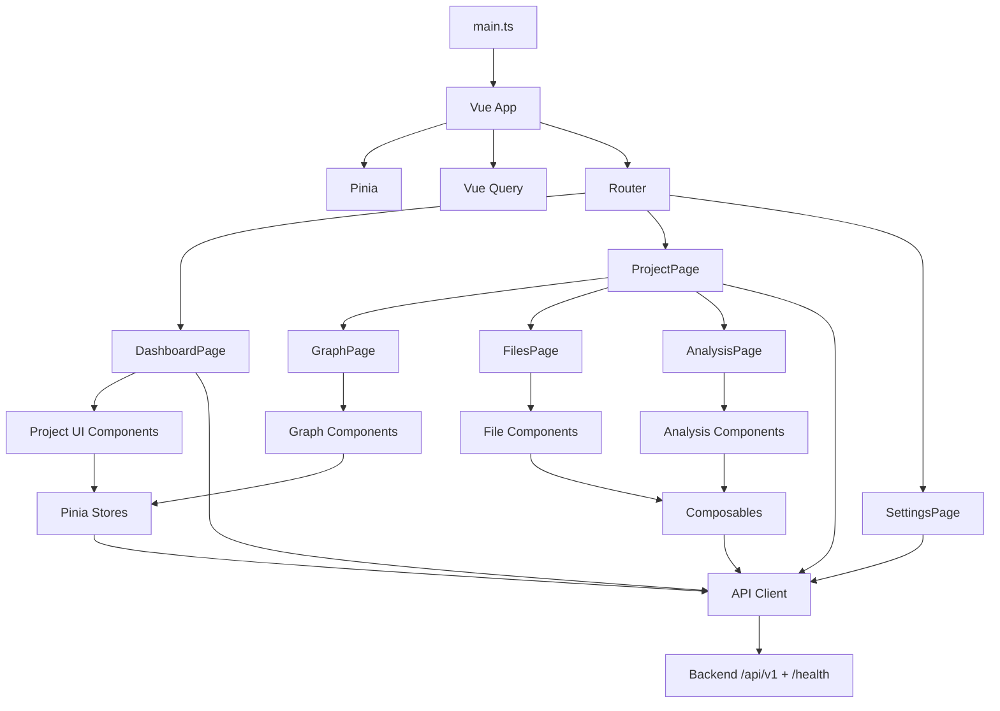
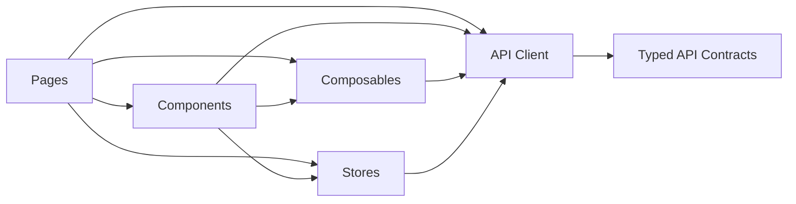
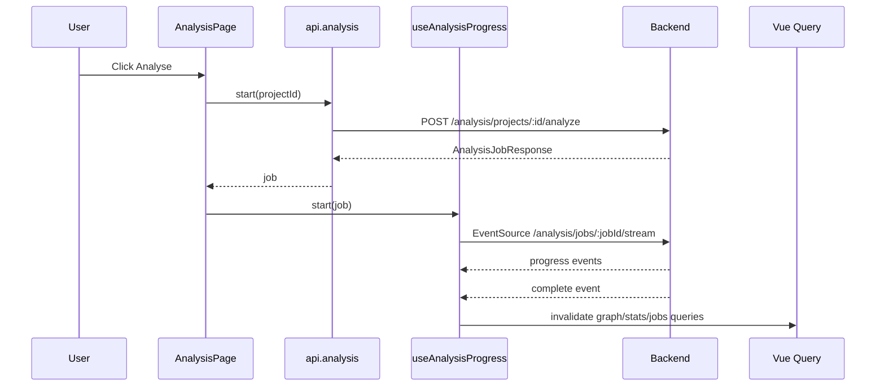

# Frontend Architecture Blueprint

Generated: 2026-03-15T11:02:48.614Z

Scope: `frontend/` only. This document was produced by analyzing the frontend application implementation, configuration, and tests under this directory. No other project directory was used as an input.

## 1. Architecture Detection and Summary

### Detected technology stack

- **Framework:** Vue 3 with Single File Components
- **Language:** TypeScript in strict mode
- **Bundler / dev server:** Vite 5
- **Routing:** `vue-router`
- **Client state:** Pinia
- **Server state / caching:** `@tanstack/vue-query`
- **Forms and validation:** `vee-validate` + `zod`
- **Graph visualization:** `cytoscape` + `cytoscape-fcose`
- **Code rendering:** `shiki`
- **Markdown rendering / sanitization:** `marked` + `dompurify`
- **Styling:** Tailwind CSS v4 plus app-specific CSS variables in `src/assets/main.css`
- **Testing:** Vitest + Vue Test Utils, Playwright

### Detected architectural pattern

The frontend follows a **layered SPA architecture** with feature-oriented composition:

- **Bootstrap layer:** app creation, plugin registration, query client setup
- **Navigation/layout layer:** router and shared shell
- **Page layer:** route-level orchestration
- **Component layer:** reusable UI and feature widgets
- **Composable/store layer:** shared client behavior and UI state
- **Integration layer:** typed API client and backend contract types

This is not a strict domain-driven or hexagonal frontend. It is a pragmatic Vue SPA with clear boundaries between routing, view orchestration, local/global state, and backend integration.

## 2. Architectural Overview

The application is centered on a code-analysis workflow:

1. Users manage projects on the dashboard.
2. Users navigate into a project shell.
3. Within a project, they upload source archives, trigger analysis, inspect the graph, and browse files.
4. Optional AI documentation generation is initiated from node details.

The key architectural principle is **thin pages over reusable infrastructure**:

- Pages coordinate route params, queries, and high-level UI states.
- Composables wrap repeatable behavior such as graph loading, SSE progress handling, and syntax highlighting.
- Pinia stores hold durable client-side UI state where multiple components need access.
- The API layer centralizes HTTP concerns and typed contracts.

## 3. Architecture Visualization

### High-level subsystem view



### Layer dependency view



### Analysis progress data flow



## 4. Core Architectural Components

### 4.1 Application bootstrap

**Files:** `src/main.ts`, `src/App.vue`

**Responsibility**

- Creates the Vue application.
- Registers Pinia, Vue Query, and router.
- Configures query/mutation retry defaults.
- Performs startup health and LLM configuration checks after router readiness.

**Patterns**

- Centralized plugin bootstrapping.
- Lazy import of `useAppStore` after router initialization.
- Global transition wrapper in `App.vue`.

### 4.2 Routing and layout shell

**Files:** `src/router/index.ts`, `src/layouts/AppLayout.vue`, `src/pages/ProjectPage.vue`

**Responsibility**

- Defines route structure and lazy page loading.
- Provides the persistent shell and project-aware navigation.
- Splits project-level navigation into nested child routes.

**Patterns**

- Top-level routes for dashboard and settings.
- Nested project routes for graph, files, and analysis.
- `ProjectPage.vue` acts as a feature shell rather than a leaf screen.
- `AppLayout.vue` owns global sidebar navigation and global connectivity banner.

### 4.3 API integration layer

**Files:** `src/api/client.ts`, `src/api/types.ts`

**Responsibility**

- Centralizes backend communication.
- Encodes route paths, request shapes, and response contracts.
- Provides a single `ApiRequestError` abstraction for most request failures.

**Patterns**

- Shared `request<T>()` wrapper for JSON requests.
- Namespaced client sections: `health`, `projects`, `files`, `analysis`, `graph`, `llm`.
- Base URL resolution via `import.meta.env`, `window.__ENV__`, then localhost fallback.
- `XMLHttpRequest` is used specifically for upload progress reporting.

### 4.4 State management

**Files:** `src/stores/useAppStore.ts`, `src/stores/useGraphStore.ts`

**Responsibility**

- `useAppStore`: app-wide state such as backend reachability, active project, and LLM configuration.
- `useGraphStore`: graph interaction state such as selected node, visible node types, search term, and neighbor filtering.

**Patterns**

- Setup-style Pinia stores using refs and computed values.
- Global UI state is separated from server-fetched data.
- Graph filtering state is intentionally store-backed so multiple graph widgets can react together.

### 4.5 Composable behavior layer

**Files:** `src/composables/useGraphData.ts`, `src/composables/useAnalysisProgress.ts`, `src/composables/useCodeHighlight.ts`

**Responsibility**

- Encapsulates reusable behavior with framework-aware reactivity.
- Keeps pages/components thinner.

**Patterns**

- `useGraphData` groups related queries for nodes, relationships, and stats.
- `useAnalysisProgress` handles SSE, fallback polling, and query invalidation.
- `useCodeHighlight` provides a shared singleton-ish Shiki initialization path and lazy language loading.

### 4.6 Route pages

**DashboardPage**

- Owns project CRUD flow.
- Uses Vue Query for the project list.
- Uses `vee-validate` + Zod for create/update dialogs.
- Performs optimistic cache updates through `queryClient.setQueryData`.

**ProjectPage**

- Resolves project metadata.
- Synchronizes current project id into `useAppStore`.
- Hosts child tab routes.

**GraphPage**

- Loads graph data.
- Computes node counts by type.
- Hosts graph filtering UI, legend, canvas, stats, and node details.

**FilesPage**

- Orchestrates uploads, tree browsing, and code viewing.
- Keeps last upload session and selected file locally.

**AnalysisPage**

- Starts analysis jobs.
- Displays progress and job history.
- Coordinates real-time job feedback and graph refresh.

**SettingsPage**

- Manages LLM provider configuration and connection testing.
- Reflects configuration into `useAppStore`.

### 4.7 Feature components

**Graph feature**

- `GraphCanvas.vue` renders and updates the Cytoscape graph.
- `GraphFilterPanel.vue` manipulates shared graph filter state.
- `NodeDetailPanel.vue` provides a detail drawer, code snippet preview, and AI docs generation.
- `GraphLegend.vue` externalizes graph color semantics.

**Files feature**

- `UploadZone.vue` handles ZIP validation, drag-and-drop, upload progress, and errors.
- `FileTreeNode.vue` lazily expands directory contents.
- `CodeViewer.vue` displays full-file highlighted content with optional line scrolling.
- `CodeSnippet.vue` displays bounded highlighted excerpts.

**Dashboard / shared UI**

- `ProjectCard.vue` is the core reusable project listing unit.
- Analysis widgets such as `JobHistoryTable.vue`, `ProgressBar.vue`, and `AnalyseButton.vue` keep `AnalysisPage` focused on orchestration.

## 5. Architectural Layers and Dependency Rules

### Implemented layer map

1. **Infrastructure/config**
   - `package.json`
   - `vite.config.ts`
   - `tsconfig.json`
   - `playwright.config.ts`

2. **Bootstrap**
   - `src/main.ts`
   - `src/App.vue`

3. **Routing/layout**
   - `src/router/`
   - `src/layouts/`

4. **Feature pages**
   - `src/pages/`

5. **Feature/shared components**
   - `src/components/`

6. **Behavior/state**
   - `src/composables/`
   - `src/stores/`

7. **Integration/contracts**
   - `src/api/`
   - `src/schemas/`
   - `src/constants/`

### Intended dependency direction

- Pages may depend on components, composables, stores, schemas, and API modules.
- Components may depend on composables, stores, constants, and API modules.
- Composables and stores may depend on the API layer.
- The API layer depends on contract types only.

### Boundary enforcement

There is no formal architectural linting, but the code mostly follows conventions:

- `@` alias encourages stable imports from `src/`.
- Typed contracts in `src/api/types.ts` reduce ad hoc data handling.
- Pages act as orchestration points rather than embedding all logic into deeply nested components.

### Notable observations

- The architecture is convention-enforced, not tool-enforced.
- Most cross-feature reuse is achieved through composables and stores rather than inheritance.
- `useGraphData(projectId.value, nodeLimit.value)` captures primitive arguments at setup time. This weakens reactivity for the intended "load more" graph behavior and is worth treating as an implementation caveat when extending the graph area.

## 6. Data Architecture

### Data model organization

The frontend models backend contracts rather than defining an independent client domain model:

- `ProjectResponse`
- `FileEntry`
- `AnalysisJobResponse`
- `GraphNode`
- `GraphRelationship`
- `ProjectStatsResponse`
- LLM settings request/response types

This keeps the client simple and tightly aligned with backend payloads.

### Data access patterns

- **Vue Query** is used for cacheable server reads and mutation coordination.
- **Pinia** is used for non-persistent client interaction state.
- **Component refs** are used for short-lived page-local UI state.

### Data transformation patterns

- Pages compute derived UI representations from query results.
- Graph node counts are computed client-side from the loaded node set.
- Markdown returned from the LLM endpoint is transformed with `marked` and sanitized by `DOMPurify`.
- File contents are transformed into syntax-highlighted HTML via Shiki.

### Validation

- User-entered project fields are validated through Zod schemas in `src/schemas/project.ts`.
- Uploads perform client-side ZIP type checks before the request is sent.

## 7. Cross-Cutting Concerns

### Authentication and authorization

No authentication or authorization implementation is present in the frontend code under `frontend/`.

Architectural implication:

- The SPA assumes an already-trusted environment or a backend that does not currently require authenticated session handling from this client.
- New auth work would need a new cross-cutting slice for route guards, credential storage, request decoration, and permission-aware UI.

### Error handling and resilience

The application uses a mostly local, view-level error strategy:

- `ApiRequestError` normalizes failed backend responses.
- Pages/components translate failures into contextual UI messages.
- `useAnalysisProgress` falls back from SSE to polling when the event stream fails.
- Health checks convert network failure into an "unreachable" banner rather than crashing app bootstrap.

Current limitations:

- Several `catch` blocks intentionally swallow parsing or fetch failures and replace them with safe UI defaults.
- There is no centralized error reporting bus or telemetry sink.

### Logging and monitoring

No dedicated frontend logging or monitoring framework is present.

Architectural implication:

- Debugging relies on browser tooling and user-visible states.
- Observability for production incidents would require a new shared instrumentation layer.

### Validation

- Schema validation is strongest on the dashboard forms.
- Upload validation is minimal and MIME/extension-based.
- Most API response validation relies on TypeScript trust rather than runtime guards.

### Configuration management

Configuration sources are:

- `import.meta.env.VITE_API_BASE_URL`
- `window.__ENV__?.API_BASE_URL`
- hardcoded localhost fallbacks
- Playwright environment variables for E2E execution

There is no feature flag framework or runtime config registry beyond API base URL and LLM form inputs.

## 8. Service Communication Patterns

### Backend communication

- **Transport:** HTTP/JSON
- **Primary API namespace:** `/api/v1`
- **Health endpoint:** `/health`
- **Real-time analysis updates:** Server-Sent Events

### Communication styles

- **Synchronous request/response:** projects, files, graph, settings, most analysis endpoints
- **Streaming:** analysis progress
- **Polling fallback:** analysis job status when SSE fails

### Caching and invalidation

- Vue Query provides client caching.
- Invalidation is used after analysis completion and file upload.
- Dashboard mutations sometimes update cache directly instead of refetching.

### API versioning

The API path is versioned via `/api/v1`, and the frontend is explicitly coupled to that path through `api/client.ts`.

## 9. Vue-Specific Architectural Patterns

### Component composition and reuse

- Route pages compose reusable feature components.
- Shared visual semantics are externalized into constants and CSS variables.
- Feature-specific reusable widgets live under `src/components/<feature>/`.

### State management strategy

- **Pinia:** durable interaction/UI state that spans multiple components.
- **Vue Query:** backend-backed state with freshness and invalidation rules.
- **Local refs/computed:** page-scoped ephemeral states such as dialog visibility and in-flight UI flags.

### Side-effect handling

- Bootstrap side effects are in `main.ts`.
- Component lifecycle hooks (`onMounted`, `onBeforeUnmount`) manage imperative libraries and startup loads.
- `watch` is heavily used for synchronization between props, route state, store state, and rendered artifacts.

### Routing approach

- Lazy route imports reduce initial bundle work.
- Nested routes model the project workspace cleanly.
- Route params are used directly inside pages as the primary context key.

### Rendering optimization

- Lazy page imports.
- Query stale times for graph data.
- Shared highlighter instance reduces repeated initialization.
- Lazy file tree child loading avoids loading the entire hierarchy eagerly.

## 10. Implementation Patterns

### API implementation pattern

- Keep all backend calls inside `src/api/client.ts`.
- Export narrow methods grouped by backend concern.
- Throw typed errors rather than returning error-shaped success values.

### Page implementation pattern

- Resolve route params first.
- Create queries/mutations next.
- Derive computed UI state from query + local refs.
- Render mostly declarative templates with feature components.

### Store implementation pattern

- Use Pinia setup stores.
- Expose both raw refs and derived computed values.
- Keep store logic focused on state transitions, not broad view orchestration.

### Composable implementation pattern

- Encapsulate behavior that can be reused across views.
- Return both transformed values and underlying query handles when useful.
- Use lifecycle cleanup for event streams, timers, and external objects.

### UI implementation pattern

- Prefer Vue SFCs with `<script setup lang="ts">`.
- Keep styles scoped at the component level, while global tokens live in `main.css`.
- Use Lucide icons for visual consistency.

## 11. Testing Architecture

### Unit/integration-style frontend tests

Detected under `frontend/tests/unit/`:

- API client behavior
- Graph store behavior
- File tree component behavior
- Code highlight composable behavior
- Graph-related constants/tests
- Project schema validation

These tests indicate a focus on:

- utility stability
- UI state behavior
- validation rules
- contract/error-handling correctness

### End-to-end tests

Detected under `frontend/tests/e2e/` with Playwright:

- Dashboard loads
- Dialog opens
- Form validation is visible

### Test tooling architecture

- **Vitest** for fast unit tests in `jsdom`
- **Playwright** for browser-level verification
- **Vue Test Utils** for component testing

The current coverage is useful but selective. Complex page orchestration paths, query invalidation flows, SSE fallback behavior, and settings persistence would benefit from additional tests if those areas evolve.

## 12. Deployment Architecture

### Build and runtime

- `vite build` produces a static SPA bundle under `dist/`.
- Development runs through Vite on port `3000`.
- Dev proxy forwards `/api` traffic to `VITE_API_BASE_URL` or `http://localhost:8080`.

### Containerization

The `frontend/` directory includes:

- `Dockerfile`
- `nginx.conf`
- `docker-entrypoint.sh`

This implies a deployment model where:

- Vite is used for build-time bundling.
- Nginx serves the built SPA in runtime environments.
- Runtime environment injection is likely supported through entrypoint/environment processing.

### Environment-specific behavior

- Local development defaults to Vite dev server.
- E2E tests can reuse an existing dev server or start one automatically.
- Production-like environments likely serve static assets via Nginx.

## 13. Architectural Decision Records

These are inferred from the codebase rather than recorded explicitly.

### Decision: Separate server state from UI interaction state

**Evidence**

- Vue Query handles backend data.
- Pinia handles graph and app UI state.

**Why it fits**

- Prevents backend cache concerns from leaking into every interactive widget.
- Keeps view-specific selections and filters independent from fetch lifecycles.

**Consequence**

- Clearer mental model.
- Requires discipline to avoid duplicating the same state in both layers.

### Decision: Use composables for cross-component behavior

**Evidence**

- `useGraphData`
- `useAnalysisProgress`
- `useCodeHighlight`

**Why it fits**

- Reuse without class hierarchies.
- Good match for Composition API and reactive lifecycle management.

**Consequence**

- Easy extraction of reusable behaviors.
- Reactivity bugs can appear if primitives are passed instead of refs/computed values.

### Decision: Centralize API contracts in one typed client

**Evidence**

- `src/api/client.ts`
- `src/api/types.ts`

**Why it fits**

- Simplifies backend coupling.
- Makes page/component code cleaner.

**Consequence**

- Strong consistency for request shapes.
- Tight coupling to backend response contracts and endpoint naming.

### Decision: Render graph interaction through Cytoscape

**Evidence**

- `GraphCanvas.vue`
- `cytoscape-fcose`

**Why it fits**

- The product is graph-centric.
- Cytoscape handles node/edge rendering and layout concerns better than hand-built SVG/DOM solutions for this use case.

**Consequence**

- Enables rich graph interactivity quickly.
- Introduces an imperative island inside an otherwise declarative Vue app.

## 14. Architecture Governance

### How consistency is currently maintained

- Directory conventions are clear and meaningful.
- Shared API types and constants reduce duplication.
- Strict TypeScript settings raise the floor for correctness.
- ESLint, Prettier, Vitest, and Playwright are available as quality gates.

### What is not currently automated

- No explicit architectural dependency rules.
- No route guard framework.
- No centralized telemetry enforcement.
- No runtime schema validation of backend responses.

### Practical governance guidance

When adding or changing frontend features:

- Put backend calls in `src/api/client.ts`, not directly in components.
- Put shared reactive behavior in composables.
- Use Pinia only for interaction state that must outlive a single component.
- Keep page files as orchestration points and avoid moving all logic into templates or one-off components.

## 15. Blueprint for New Development

### Recommended workflow for adding a new feature

1. **Define the route context**
   - Decide whether the feature belongs on a top-level page, a project child route, or an existing page section.

2. **Add or extend API contracts**
   - Create request/response types in `src/api/types.ts`.
   - Add transport methods in `src/api/client.ts`.

3. **Choose the state home**
   - Vue Query for backend state.
   - Pinia for shared interactive state.
   - Local refs for purely local UI state.

4. **Extract reusable behavior**
   - If the logic involves lifecycle, async orchestration, or reuse, create a composable.

5. **Build page and feature components**
   - Keep page components responsible for orchestration.
   - Keep feature components focused on presentation and local interaction.

6. **Add tests at the right layer**
   - Utility/composable/store tests in `tests/unit/`
   - Important user workflows in `tests/e2e/`

### Standard file placement

| Concern | Recommended location |
| --- | --- |
| New route page | `src/pages/` |
| Shared app shell UI | `src/layouts/` or `src/components/ui/` |
| Feature-specific UI | `src/components/<feature>/` |
| Reusable behavior | `src/composables/` |
| Shared UI/client state | `src/stores/` |
| Backend calls/contracts | `src/api/` |
| Validation schemas | `src/schemas/` |
| Shared constants | `src/constants/` |

### Implementation template

```ts
// api/types.ts
export interface ExampleResponse {
  id: string
  name: string
}

// api/client.ts
example: {
  list: (): Promise<ExampleResponse[]> => request('/example'),
}

// composables/useExampleData.ts
export function useExampleData(projectId: string) {
  return useQuery({
    queryKey: ['example', projectId],
    queryFn: () => api.example.list(),
    enabled: !!projectId,
  })
}
```

### Common pitfalls to avoid

- Calling `fetch` directly from pages/components instead of the API client.
- Duplicating the same state in local refs, Pinia, and Vue Query simultaneously.
- Passing non-reactive primitive snapshots into composables that are expected to react to later changes.
- Adding large imperative libraries without isolating them behind a focused component or composable.
- Rendering untrusted HTML without sanitization.

### Extension points already present

- New graph interactions can extend `useGraphStore` and graph feature components.
- New AI-assisted features can follow the `NodeDetailPanel` pattern: API method -> async UI action -> sanitized rendering.
- New project-level tabs can be added through nested project routes.
- Additional validation schemas can follow the existing Zod + `vee-validate` approach.

## 16. Key Implementation Caveats

These are not blockers for understanding the architecture, but they matter when evolving it:

- The graph area intends to support incremental loading, but the current `useGraphData` invocation pattern does not fully model `nodeLimit` as reactive query input.
- Error handling is user-friendly but decentralized; larger feature growth will benefit from a shared error/notification mechanism.
- Backend contracts are trusted at runtime; if backend payloads become less stable, runtime validation will become more important.
- The absence of authentication means any future secure deployment will require cross-cutting architectural additions, not just isolated screens.

## 17. Recommended Next Maintenance Step

Keep this blueprint aligned with the code by revisiting it whenever one of these changes occurs:

- a new top-level route or project tab is added
- a new global store is introduced
- a second real-time channel besides analysis progress appears
- authentication or telemetry is added
- graph loading/filtering strategy changes materially

If those changes happen, update the diagrams, dependency rules, and extension guidance first so future development keeps the same architectural shape.
